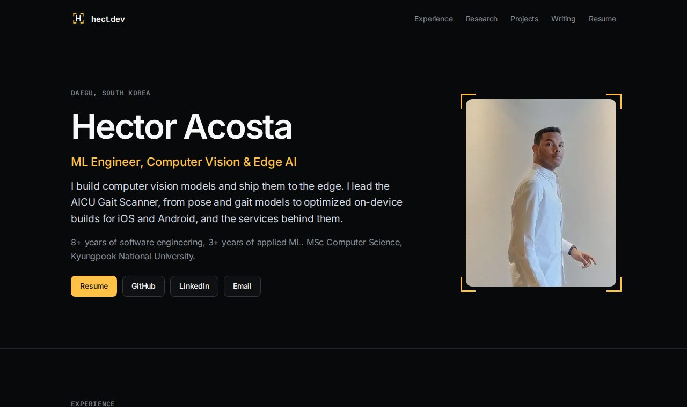

# hect.dev

Personal site and resume of Hector Acosta: **https://hect.dev**. Static Astro build, deployed on Netlify.



- One data file, `src/data/profile.ts`, feeds the home page, `/resume`, the resume PDF and the JSON-LD.
- `/writing/<slug>` and `/research/<slug>` are share pages with Open Graph previews for articles and papers
  hosted elsewhere, so they preview on LinkedIn even when the original site blocks crawlers.
- Images go through `astro:assets` (responsive WebP); everything is served from the same origin under a strict
  Content-Security-Policy, set with the other security headers, caching and redirects in `netlify.toml`.

```bash
npm install
npm run dev        # http://localhost:4321
npm run build      # dist/
```

After changing the profile data, regenerate `public/resume.pdf` and `public/og.png` with a preview server running:

```bash
npm run build && npx astro preview &
npx playwright install chromium && npm run render
```
